# dsh-chatroom · 多人个人聊天室

[](https://github.com/dingchenhui0618-arch/dsh-chatroom/actions/workflows/test.yml)

在 DeepSeek Harness 里开一间屋子：**你**、**你带进来的 agent**，以及**局域网另一台机器上的人和它的 agent**
一起说话。agent 不是「问一句答一句」的工具，而是屋里的成员 —— 有名字、有职责、有自己独立的会话历史。

> **当前状态（诚实版）**：本机房间、三条并行发言规则、LAN 加入与跨机派发、悬浮窗与未读提醒都已跑通；
> 真模型在真宿主里跑过一轮（见「验证状态」）。逐项证据在下面。

## 截图

十六张图都是**真渲染**：页面里跑的就是本仓库的 `lib/client.js`，数据来自 `src/host` 里那几份真状态机
（房间、成员、消息、未读游标、发言规则、LAN 派发都是真的走一遍），不是手画的 mockup。
屋里那几位 `LAN` 成员不是画上去的：面板、agent 表单、邀请、规则、加入方视角、三台机器同屋、版本不一致、已解散这几张里，
他们都是另外的进程用房间码真的加入进来的；「三台机器同屋」那张是**第三个进程**也进了同一间屋；
「已解散」那张是**宿主真的把屋子解散**之后，加入方那边渲染出来的样子；
「版本不一致」那张里的旧版本机器也是手写老协议 payload 真进屋的（不带能力位，所以它确实报不了名单）。


**刚装好时看到的第一屏**。一间屋子都还没有的时候，中栏不是一块留白：一句话说清房间在谁那台机器上、
另一台机器怎么进来（地址 + 六位房间码），下面两个入口（新建房间 / 加入 LAN 房间）当场可用 ——
点下去开的就是左栏那张表单；这时成员列整列收起来，不占着一根空列。
这一屏也是唯一能看出「主按钮文字在真主题里还在不在」的地方：默认深色主题的品牌色是近白 `#f9fafb`，
主按钮原来写死 `color:#fff`，于是白底白字、字整个消失（见下面验收表里那条）。


**房间面板**。左：房间列表与预览，底部是「我的 agent」（这台机器带谁进屋）、「我的名字」（对面看到的就是它）
和「加入 LAN 房间」的入口；
中：群聊（`本机` / `LAN · 周荻的 MacBook` 的标记跟着消息走），新消息进来会跟着滚到底，自己往上翻历史时不打扰；
右：成员与规则入口；底部只在有人发言时显示谁在说，平时显示「几人 · 几个 LAN」。

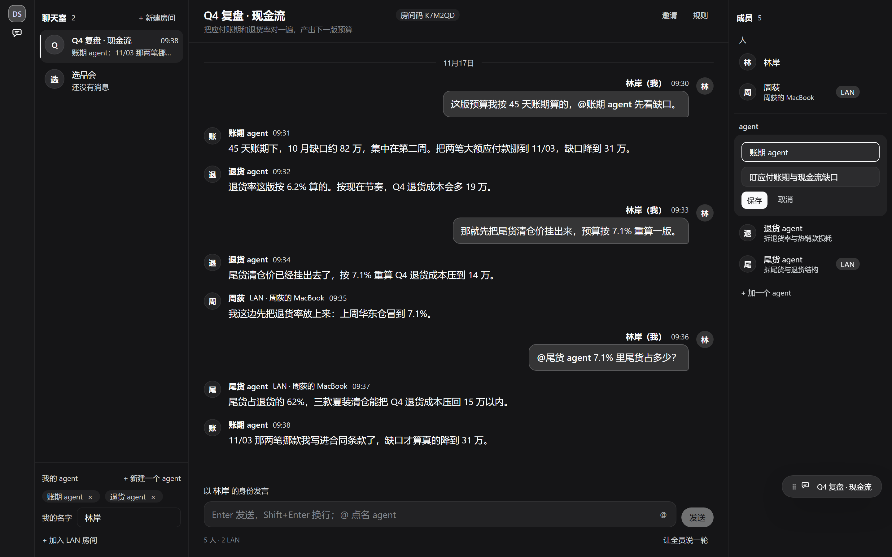

**agent 的名字和职责随时能改**：成员行上「改」→ 表单原地展开，填名字和职责 → 保存。
职责不是备注，它会被写进这个 agent 每一轮的 prompt（`你的职责：…`），所以看到它在屋里说得不对味时，
改的是这一栏，不是重新建一个成员。

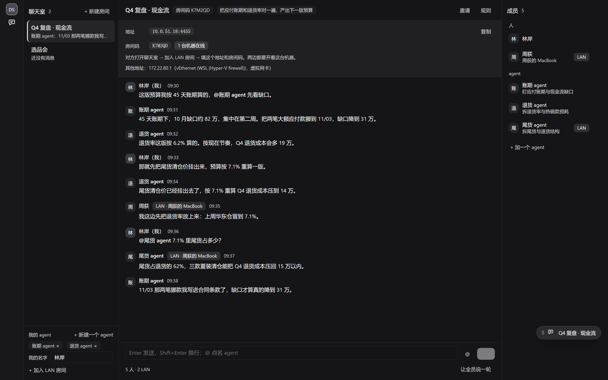

**邀请**：局域网地址 + 六位房间码就是全部凭据，没有账号、没有注册。点「复制」把这一行发给对方即可。
装了 WSL / Hyper-V / 虚拟机的机器会有好几个地址，这里只把**最可能连得上**的那个放在上面，
其余列在下面一行并标出「虚拟网卡」—— 免得人抄了一个本机自己通的 `172.x` 过去，然后对着超时猜原因。


**三条发言规则是并行开关**，不是三选一：被 @ 必回、全员各说一句、设主持人；
下面那条「每条最多引出 N 个回复」是共用的预算闸门。


**同一间屋子，另一台机器上看到的视角**：它自己的人和 agent 不贴标签（本机就是默认），
宿主的成员标 `LAN · 林岸的 MacBook`，标题栏写「由 林岸的 MacBook」；规则与成员由对端管理，这边只能发言。

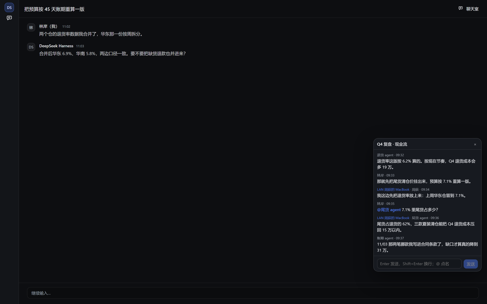

**会话界面里的独立悬浮窗**：标题栏右侧的开关拉起，可拖动、可折叠，Enter 直接发；收起成胶囊以后
那颗胶囊同样拖得动，点一下才展开。远程成员的消息在浮窗里同样带 `LAN + 机器名`，不用点进面板也能分清是谁在说。


**消息提醒**：新消息进来时侧栏图标、悬浮胶囊、标题栏开关都带未读数，右上角给一条 toast，
页面标题前缀同步成 `(1) …`（`document.title`）。这些数字也会落回去：面板正停在那间屋子上、
或者展开浮窗（都等于「看过了」），游标就推到最新一条；面板被切走、标签页在后台时**不会**替你清，
否则提醒就废了。

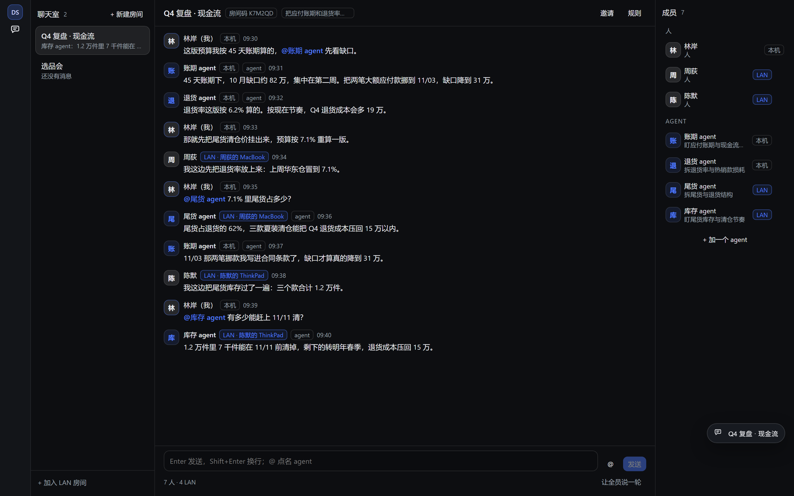

**三台机器同屋**（宿主视角）：本机的「林岸 + 两个 agent」，加上两台用房间码进来的机器 ——
周荻的 MacBook（周荻 + 尾货 agent）、陈默的 ThinkPad（陈默 + 库存 agent）。
每一条消息和每一个成员都标到**机器**，不是笼统的一个「LAN」：`LAN · 周荻的 MacBook` /
`LAN · 陈默的 ThinkPad`，本机的成员不贴标签（不标才是本机）。这张图不是摆拍：第三个进程真的握手、真的发言，
宿主那句 `@库存 agent 有多少能赶上 11/11 清？` 也是真的被派发到第三台机器上跑完再回传的。

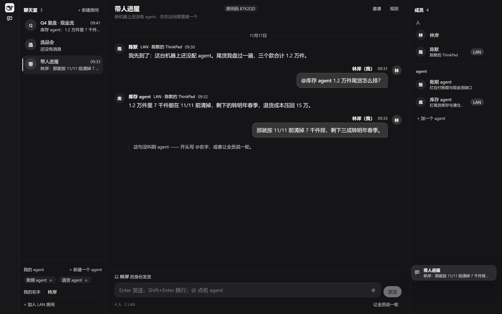

**agent 怎么进来**：能带进别人屋子的，是**本机已经有的** agent —— 加入那一刻把名单报给宿主，
宿主把它们建成成员（`owner` 指向那台机器），轮到它们时把这一轮**派回那台机器**，
用它自己给这个 agent 的会话跑完再回传（记忆长在它自己那台机器上）。
可是新装的机器上一个 agent 都没有 —— 人是先挤进屋、才想起要带谁。
所以左栏补了「我的 agent」：建完立刻把名单报给宿主，对面成员列当场多一个人；
之后改名、改职责也会跟着变，删掉则把成员一起撤掉，不留一个永远不回话的成员。
这张图里「陈默的 ThinkPad」就是空手进来的，`库存 agent` 是**加入之后**才建的：
宿主那句 `@库存 agent 1.2 万件尾货怎么排？` 真的被派回那台机器跑完才落库。
成员列里它是 `LAN`，本机的「账期 agent」没有标签 —— 归属一眼分得开。

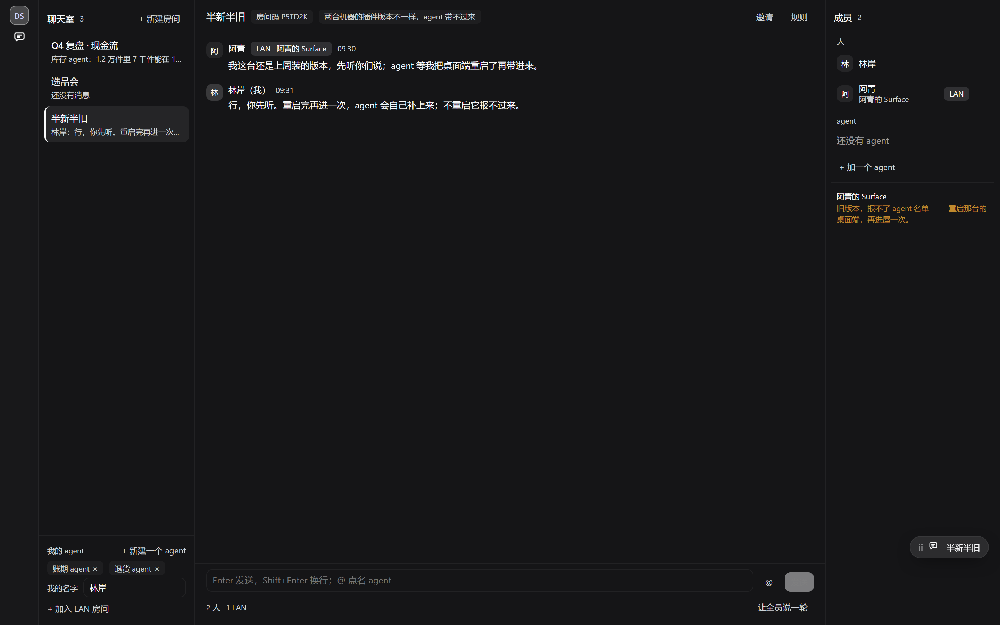

**对面那台还是旧版本**：补报名单靠的是加入方那台机器上的 `/lan/agents`，
旧版本没有这个接口、也没有左栏那个「我的 agent」入口 —— 于是它进屋时屋里只有他一个人，
而「没 agent」和「带不进来」看起来一模一样。所以宿主这边不让人猜：
右栏成员列下面直接写清**是哪台机器、缺什么、该做什么** ——
`阿青的 Surface / 旧版本，报不了 agent 名单 —— 重启那台的桌面端，再进屋一次`。
两种「没 agent」分得开：版本旧是警示色、要重启；那台还没建则是「去它的左栏建一个，建完自动进来」。
反向也一样：加入方撞上旧版本宿主时，右栏会写明「宿主的插件是旧版本，agent 名单报不过去」。
这不是网络故障，重试没用 —— 已经跑着的进程里是**装载那一刻**的代码，得让它重新装载：
重启那台的桌面端，或者在设置 → 插件里把 `dsh-chatroom` 关掉再打开（实测宿主半边会重新求值，
见下面探针那节）。

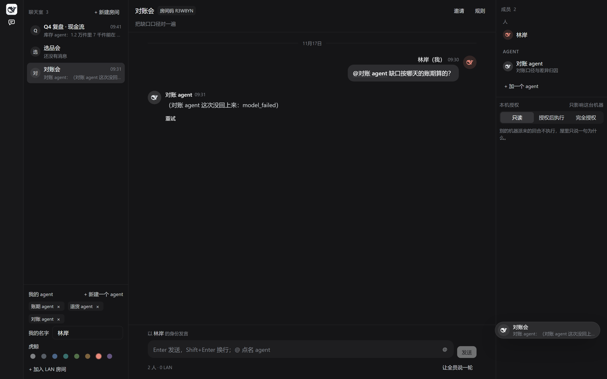

**agent 没回上来**：失败不会悄悄消失 —— 占位消息留在房里（带错误码，灰色的那行），
底下一个「重试」只把**它**重跑一次：不惊动屋里其他 agent、也不换会话，回复按 seq 接在后面，
所以失败的痕迹和成功的回复都在。这一轮还在发言时按钮是按住的（宿主会拿 `room_busy` 挡住）；
加入方的镜像是只读的，重试只在宿主那台机器上发起。
这张图也是真的：假模型被点名挂了一次，占位消息由 `speak.js` 自己落下，断言里再点一次「重试」，等新回复落库。

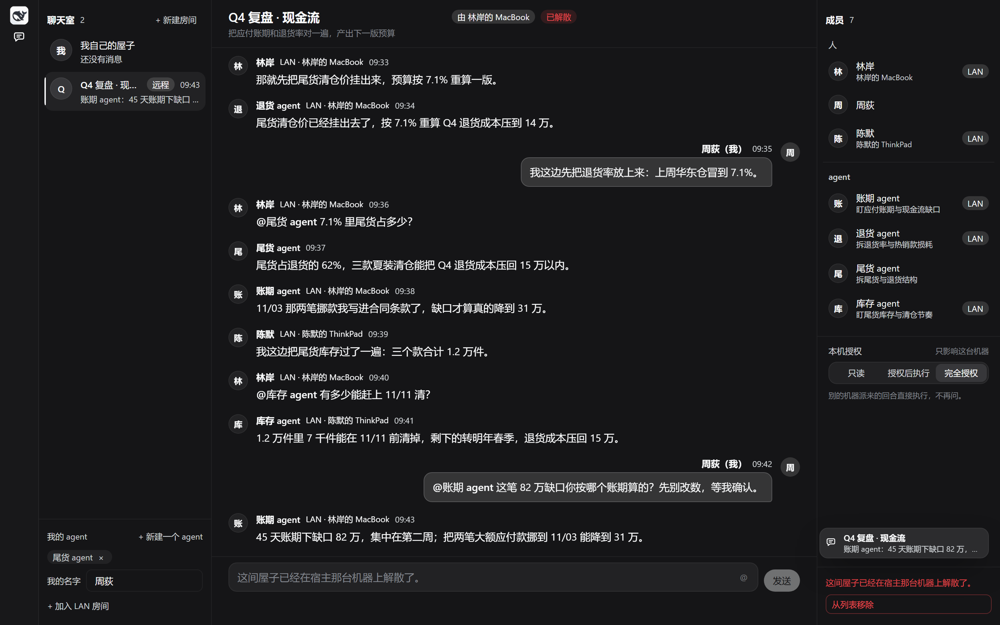

**宿主把那间屋子解散了**（这张图里的解散是真的发生了一次 `room.dissolve`；屋里当时已经有上面那三台机器、
7 个成员，解散前三台机器的历史都还在）：加入方的镜像不删，
改成一条墓碑 —— 历史还在、标题栏标 `已解散`、输入框锁住并写明原因，右栏只留「从列表移除」。
不这么做的话，加入方会卡在一个发不出话、也没有「离开」入口的房间里。

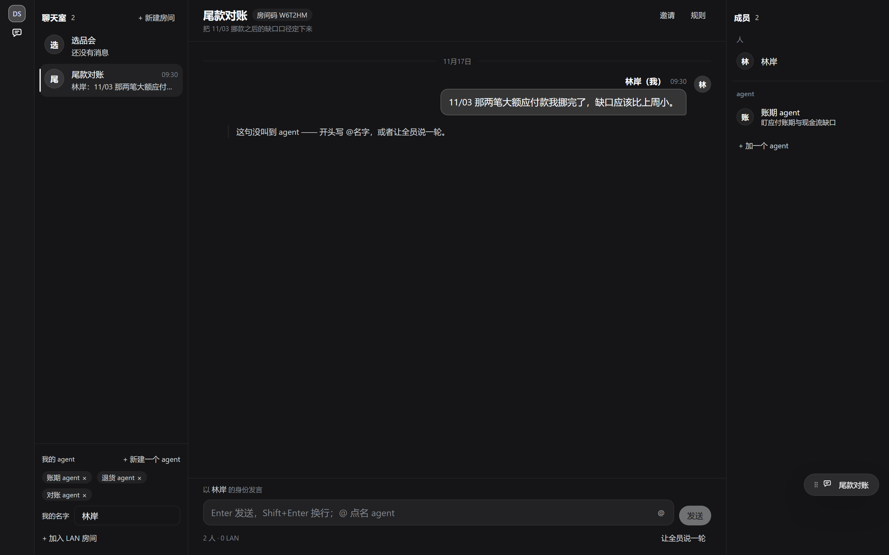

**说完一句，谁都没接**：默认只开「被 @ 必回」，所以一句没点名的话不会有任何 agent 接 ——
界面原来对此一个字都不说，第一次用就像插件坏了。现在那句话下面直接写清原因：
`这句没叫到 agent —— 开头写 @名字，或者让全员说一轮。`（三种规则全关时换成「三种发言规则都关着」）。
它不去猜宿主调度到哪一步（那是异步的，猜早了会误报），只看投影里已经有的事实：最后一条是不是我刚说的、
屋里有没有 agent、我有没有点到它、此刻还有没有规则能接话 —— 所以 agent 一接话、我再说一句、或者规则被打开，
它自己就消失，不会变成一条一直挂着的噪音。浮窗里也有输入框、也会撞上这片安静，
那儿用的是不指明按钮的短说法（浮窗里本来就没有「让全员说一轮」可点）。
这张图也是真的：假模型没被叫到，所以那段时间真的没有回复；断言里接着把输入框改成 `@账期 agent …`
点「发送」→ agent 真的接上话 → 再断言那句解释自己消失（正面反面都验了）。

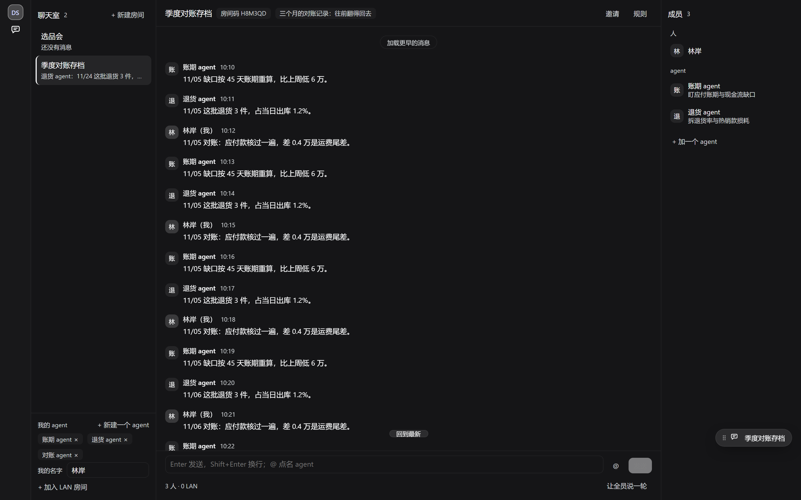

**说过的话翻得回去**。投影只带最近 200 条（房间能存 4000 条），所以一句话说到 200 句之后，
更早那些话原来就只剩列表底部一句「只显示最近 200 条」——看得见提示、找不到出口。
现在列表顶端是「加载更早的消息」：点一次往回拿一页（默认 100 条，上限 200，也就是一屏），
翻到最早一条入口自己消失；翻完视口停在原处，不会把人从正在读的那句甩走。
人停在上头之后，底部会浮出「回到最新」—— 一步踩回最新那句，不用拿滚轮重新滚过几百行。
这一屏是一间真的说满 240 句的屋子（对账记录，人跟 agent 交替），
断言里点一次入口 → 消息从 200 条变成 240 条、第一条变成 `11/01` 那句、入口消失、
最新一条仍是 `11/24`、滚动位置没被跳回顶部；接着点「回到最新」→ 离底部 0px、
翻出来的历史还都在、出口自己消失。

停在上头的时候，屋里又进来话 —— 那几句在屏幕上根本看不见，所以出口上要写清「几条新的」
（`回到最新 · 2 条新的`），而且**不能把人拽下去**；自己滚回底部或点出口，计数清零。
这里还藏着个不显眼的坑：投影是跟着新消息往前滑的，翻出来的那页停在更早的位置，两段中间会
裂开一道缝 —— 那几句既不在翻出来的页里、也不在投影里，谁都不去要就永远看不见
（滚动时时间戳会突然从 `11/03` 跳到 `11/05`）。所以新消息进来时按投影首句往回补一次，
时间线才是连续的。下面这张拍的就是这个中间态：先把一整段历史翻出来、滚到顶上，再让屋里
真的进来两句；断言里条数从 240 变 242，把补缝那行去掉立刻变回 240。

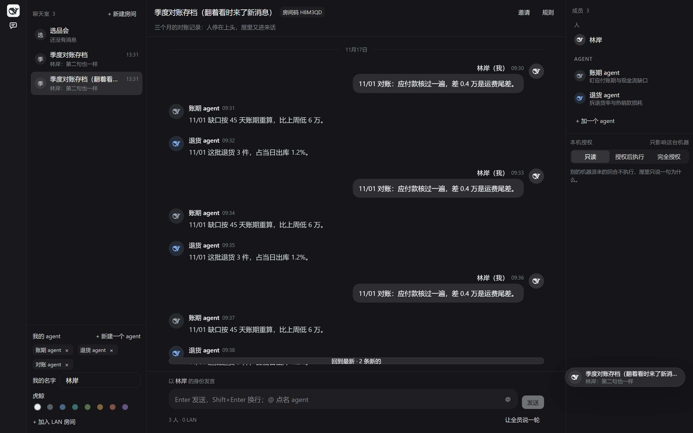

加入方那台机器也能翻：镜像里只有宿主发过来的 200 条，更早的走 `/lan/messages` 去宿主那台要，
而且**只能翻到自己加入的那间屋子**（房间从凭据里认，不是从请求里认）。

> 截图口径：`docs/*.png` 由 `tools/preview/` 用无头 Chrome 截取，视口 1440×900、2× 缩放。
> 预览服务器起**两份预览页面**（3491 宿主 / 3492 加入方）；第三台机器、以及「空手加入再补建 agent」
> 那台机器，都在同一个进程里各起一份 Store 与 LAN 监听、走真实协议按需加入
> （它们只出现在宿主那几张截图里，自己没有预览页面）。
> 各份各有自己的 Store 与 LAN 监听，互相走真实的局域网 HTTP 协议。外壳（左侧图标栏、会话标题栏与那两行对话、输入框）是**替身**，
> 只为给出真实尺寸与上下文；聊天室的面板、悬浮窗、规则区、提醒全部是插件自己的真实渲染。
> 替身外壳的取色照 DSH 默认深色主题的**真实 token**（`#151517` 底、`#f9fafb` 主文字与品牌色、`#cfd3d6` 次要文字、
> `#2c2c2e` 抬起层、`#ffffff0f` 发丝线），并把同名 `--dsw-alias-*` 原样摆在页面上 ——
> 所以图里插件走的是宿主那一套颜色，不是「取不到宿主 token 时的回退色」。
> 「刚装好」那一屏要的是**一间屋子都没有**的宿主：主预览服务里房间早就种好了，拿它截不出来，
> 所以截图脚本会按需另起一台 `PREVIEW_EMPTY=1` 的服务（同一个 `server.mjs`、同一份真状态机，只是不种房间），
> 截完就关，不动你自己跑起来的那台。
> 侧栏那枚圆角图标钉进了自己的一层（`transform: translateZ(0)`）：不钉的话它两次截图之间会落在半像素上，
> 抗锯齿边缘差 1–6/255，重跑比对就不是逐字节相同了。钉住之后两轮独立重跑 **17 张图 0 像素差异**。
> 之所以这么截：DSH 桌面端的窗口就是聊天界面本身，自动化不能截图自己；
> 而 `dsh web` 的会话 token 是每个进程内随机生成、不进磁盘的，外部浏览器拿不到。
> 截「已解散」那张之前，预览服务器会先调一次宿主的 `room.dissolve`（走插件自己的 command，不是摆拍），
> 等加入方自己认出「屋子没了」，再截；「补建 agent」「版本不一致」两张拍完之后，它们专开的演示例房间会在断言里收掉，
> 免得出现在后面几张图的房间列表里。
> 「版本不一致」那张里的旧版本机器同样是真实协议进屋的：手写一份**不带能力位**的老 payload 打 `/lan/join`，
> 再让它照常发一条言 —— 不走新客户端，所以它「报不了 agent 名单」是真的报不了，不是界面上假装。
> 「加入失败」那张连的端口也是钉死的：从 `4599` 往下找一个没人监听的候选号，
> 因为那句报错文案里就带着端口号，随机会让每次重跑都得到一张不一样的图。
> 复现：`npm run preview:build && npm run preview:serve && npm run preview:shots`。
> 调某一屏时可以只跑它：`node tools/preview/shoot.mjs --only=history`（多屏用逗号）；
> 整轮验收仍然不带参数全跑（而且必须是刚起、`/preview/writes` 为 0 的服务器）。

### 界面规格

面板只有三样东西：一条发丝线分层、一处品牌色、一套间距。写样式前先把变量钉死：

- **颜色 / 间距 / 圆角先落 token**：`.cr-main` / `.cr-float` / `.cr-toast-wrap` 上定义
  `--cr-fg / --cr-muted / --cr-line / --cr-surface / --cr-accent / --cr-hover / --cr-raised / --cr-r / --cr-s1..s5`，
  组件里只引用变量。取值优先用宿主的 `--dsw-alias-*`，取不到才退回中性值 —— 明暗主题不需要各写一套。
- **间距只走 4/8 栅格**（4 / 8 / 12 / 16 / 24），字号只有 11 / 12 / 13 / 14 四档，圆角只有 8 / 12 两档。
  原来散在组件里的 2 / 6 / 10 / 13 这类数字已经全部收掉。
- **不做盒子套盒子**：规则区、邀请条、agent 表单从「描边小卡片」改成发丝线分隔的段落；
  选中的房间只加一条 2px 品牌色竖条，不给整块描边；消息之间只留空白，不画气泡。
- **本机是默认状态，不给它贴标签**：只有 `LAN · 机器名` 带色块。成员副标题只放有信息量的东西 ——
  agent 放职责，跨机器的那位放他用的机器名，本机的人就一行名字。消息行同理，不再重复一个 `agent` 标签。
- **两个抓手都能拖**：展开的标题栏和收起后的胶囊共用一套拖动逻辑（抓手处是点阵纹理 + `cursor:grab`），
  拖动中夹在视口内，松手写 `localStorage`，双击标题栏回到右下角；胶囊上单点仍是展开。

## 它解决什么

DSH 原本是「你和一个会话」一对一。当你有三个四个 agent、想让它们**在同一个上下文里互相看、
互相补、你插话拍板**时，缺的不是模型，是一间屋子和一套发言秩序。这个插件补的就是这一层；
再往前一步：**隔壁那台机器上的人也想带他的 agent 进来**，于是有了 LAN 房间。

## 三种发言规则，同时存在

| 规则 | 行为 | 默认 |
| --- | --- | --- |
| 被 @ 必回 | 房间里谁 @ 了某个 agent，它一定回 | 开 |
| 全员轮次 | 你发一条，所有 agent 依次各说一句 | 关 |
| 主持人 | 设一个 agent 当主席：话先交给它，它回复里 @ 了谁就继续接给谁 | 关 |

三条同时开会撞车，所以有一条总预算：一条人消息最多引出 `maxSpeakers`（默认 3）个 agent 回合，
agent 之间接力最多 `maxDepth`（默认 2）层。预算烧完就停 —— 这是防止一屋子 agent 互相客套把
token 烧光的唯一闸门。

预算之外还有两条硬规矩，都是为了「三条规则真的能同时开」：

- **一轮之内同一个人只说一次**。主持人 @ 了 B，全员轮次的队列里也有 B —— B 只说一句，
  预算不会被同一个人吃两遍，排在后面的人不会永远轮不到。
- **正在发言时你插的话不会被吞掉**。真实房间里一轮要好几秒，你正是在这时候补一句「@C 等会儿你单独说」；
  这句会排到这一轮结束后接着按同一套规则处理，而不是发了没反应。

默认只有「被 @ 必回」是开的，所以**没点名的话谁都不会接** —— 这不是坏了：
面板会在那句话下面写明「没叫到 agent，怎么写才叫到」，三种规则全关时则直说是规则的事。
见下面那张 `docs/no-reply.png`。

## 两台机器怎么进同一间屋

**宿主那台**：面板右上「邀请」→ 看到 `地址:端口` 和房间码（形如 `10.0.51.18:4399` / `K7M2QD`）。
装了 WSL2 / Hyper-V 的机器上还会有 `172.x` 这类虚拟网卡地址：邀请条把真实网卡排在前面，
其余写在下面一行并标「虚拟网卡」—— 抄那个过去只会一直超时。

**加入那台**：先填左栏底部的「我的名字」（这就是对面看到的名字），再点「＋ 加入 LAN 房间」→ 填地址和房间码 → 加入。
不填名字也能进，只是两边都自称「我」的时候，宿主只能用机器名兜底称呼你。

**带谁一起进去**：左栏底部的「我的 agent」列的就是这台机器的 agent。
加入那一刻它们会一起进屋（加入面板上也写着「进屋会带上：…」）；新装的机器上还一个都没有，
所以**加入之后再建也来得及** —— 建完立刻报给宿主，对面成员列当场多一个人，不用退出来重进。
只是名字/职责改了、或者删掉了一个，同样会同步过去（历史消息保留当时的署名）。

**两台机器都得让进程装载过新代码**：补报名单用的是新接口（`/lan/agents`）。
只刷新页面换的只是界面，宿主那半边还是旧代码 —— 所以装完/更新完插件要**重启桌面端**，
或者在设置 → 插件里把 `dsh-chatroom` 关掉再打开，两边都是。哪台没换过来，界面会直说
（见上一节那张图），不用靠试。

进来之后：

- 两边看到的是**同一间屋子、同一份 seq**，谁说话都会出现在对方那边；
- 各自的人和 agent 都标 `本机`，对方的标 `LAN · 机器名`，不会混淆；
- **名字随时能改**（左栏底部「我的名字」，回车或离开输入框生效）：改完宿主那边的成员列当场跟着换，
  历史消息保留当时的署名 —— 改的是「以后你叫什么」，不是把过去的话按新名字重写一遍；
- **轮到对面机器上的 agent 说话时，宿主不会替它说**：宿主把这一轮派发过去，那台机器用
  **自己本地的原生 session** 跑完，再把话回传落库 —— 所以它的记忆长在它自己那台机器上，
  这才是「真人和他携带的 agent」；
- 45 秒没有回音就落一条失败占位（`某某这次没回上来`），这一轮不会卡死；
- 加入方的房间是**镜像**：规则、成员、解散都在宿主那台改，这边只能发言；
- **宿主重启**后旧凭据作废：这边不用手动重连，下一次发言会自己重新握手 —— 并发也只握一次，
  屋里不会因此冒出两个「我」；
- **加入那台自己重启桌面端**（换代码、装完插件）也照样回得来：这条 link 是落盘的，
  重启后拿同一个 id 重新握手，宿主认出是**同一个人回来了** —— 人和 agent 的成员 id 都不变，
  所以不会出现两个「周荻」、不会 @ 到一个已经不在的幽灵，自己过去说的话也还是自己说的
  （已读位置也接着算，不会整段历史重新变未读）；要是重启那一刻正好有一轮派给它，
  这一轮也跟着交给新那组跑完，而不是过一会儿落一条「对面机器没有回应」；
- **宿主那台自己重启**（最常见的那种：装完插件、换了代码要重启桌面端）也认得出回来的是谁：
  撤人之前先把这一组（人、他带的 agent、他坐着的椅子）记成**席位**落进状态，那台机器拿同一条
  link 重新握手时按原来的成员 id 落座 —— 自己过去说的话还署在自己名下、已读位置不用重新数、
  椅子也还在；掉线超过半分钟被清扫掉再回来，走的是同一条路。主动「离开」则是真的走，
  席位一并忘掉，下次进来是新客；
- **对面那台屋子没了**（房间被解散后又清了 profile，或者这个地址上换了一台机器）：
  这边每 1.5 秒退避重试一次，不会对着它打紧循环（旧代码 2.5 秒打了 750 次），
  同时把这间屋子标成离线并给出原因 —— 人看到的是「连不上、在重试」，不是界面一直转；
- **对面关掉窗口**：宿主不再收到轮询，掉线半分钟后把它的人和 agent 整组撤掉，
  不留一条永远不回话的幽灵；正在长轮询、或正在跑模型的机器不算掉线，不会被误清；
- **宿主把屋子解散了**：加入方这边留一条「已在宿主那台解散」的墓碑 —— 历史还能看、
  输入框锁住、右栏「从列表移除」可以清掉。不会卡在一个发不出话也退不出的房间里。
  解散那一刻还在跑的那一轮会当场停掉（不再等远程、不再烧模型），也不会把 agent 记成「上次失败」。

连不上、或者怀疑两边跑的不是同一版代码时，先问一句探针（不需要房间码）：

```bash
curl -s http://10.0.51.18:4399/lan/ping
# {"ok":true,"value":{"ok":true,"hostMachine":"…","serving":true,
#   "code":{"version":"0.1.0","loadedAt":"2026-11-17T11:23:28.880Z",
#           "appliedAt":"2026-11-17T11:24:02.191Z",
#           "newestMtime":"2026-11-17T11:23:54.391Z","stale":false}}}
```

`loadedAt` 是这份代码第一次进进程的时刻，`appliedAt` 是**插件最近一次被装载 / 重载**的时刻
（每次关开都会往前走），`newestMtime` 是宿主文件在磁盘上最新的改动时间；
`stale: true` 就是在说「磁盘上已经有内存里没有的改动，得重载或重启」。插件装在 profile 里
是一份拷贝或 junction，改了文件不等于跑着的进程换了代码 —— 这一条能把「没修好」和
「修了但没生效」分开。探针**每次都重新看磁盘**（不是拿装载那一刻的快照）：
刚装好时是 `false`，改了文件再探一次就翻成 `true`，恢复文件时间又落回 `false`。

判「换没换」要看 `appliedAt` 而不是 `loadedAt`：热重载只重新求值**改过**的文件，没改的模块
（包括算这个时间戳的那个）留的是上一次的实例 —— 实测只改 `lan-guest.js` 时 `loadedAt` 一直
停在老时间上（`11:23:28.880Z`，中间重载过三次都没动），只有 `appliedAt` 在往前走
（`11:23:29Z → 11:23:48Z → 11:24:02Z`）。`stale` 就是拿 `newestMtime` 跟 `appliedAt` 比的。

`stale: true` 之后怎么让它重新装载：**设置 → 插件里把 `dsh-chatroom` 关掉再打开**即可，
不用重启整个桌面端（实测：关掉后 4399 立刻关闭；再打开 `appliedAt` 变成那一刻、`stale`
回到 `false`，`shell.overlay` 里的 `chatroom-float` 也重新注册成 active）。这是拿真实
profile 验的：那个进程从 17:28 一直跑着，磁盘上 18:16 之后修的东西一件都没进去 —— 而它
自己那份探针还是旧的、只会报装载那一刻的快照，所以看起来一切正常；换成当前代码后，
改一个文件再探立刻翻成 `stale: true`，重新装载又回到 `false`。

想先验网络通不通（防火墙、网段、房间码），用自检脚本，不烧 token：

```bash
# 机器 A
node tools/lan-check.mjs host --port 4399
# 机器 B（按 A 打印的命令照抄）
node tools/lan-check.mjs guest --host 10.0.51.18:4399 --code K7M2QD
```

宿主那台打印的地址和邀请条是同一套口径：**第一个**才是对方连得上的那个，其余列在下面并标
「虚拟网卡」（WSL / Hyper-V / Docker 的地址只有本机自己通）；整台机器只剩虚拟网卡时会直接
提示先连 WiFi 或网线。

加入方那台会验两段路，两段都过才算出结果：

1. 我发一句 @ 对面那台机器的 agent → 它回一句（我这台 → 房间码 → 对面会话）；
2. 我 @ 我自己带过去的 agent → 宿主把这一轮**派回我这台**，由它的原生会话跑完再回传
   （少这一段，「人带着自己的 agent 进屋」只是半条路）。

Windows 上连不上，先看入站防火墙。第一次监听时系统会问「允许访问」，选允许就够了 ——
但那条**程序级**规则只覆盖当时那个网络类型（实测这台机器是「公用」：
`DeepSeek Harness` 与 DSH 自带的 node.exe 各有一条已启用的入站规则，TCP 全端口）。
换了网络类型（家里 Wi-Fi 常是「专用」）、或当时点了取消，就补一条按端口的（不带
`-Profile`，三档都覆盖）：

```powershell
New-NetFirewallRule -DisplayName "dsh-chatroom" -Direction Inbound -Protocol TCP -LocalPort 4399 -Action Allow
```

## 安装

插件市场那条条目给出的命令就是 `github:` spec，装到哪个 profile 就把 `--profile` 换成它：

```bash
dsh plugin --profile <你的profile> add github:dingchenhui0618-arch/dsh-chatroom
```

本机已经有这个仓库的目录时，也可以直接装目录：

```bash
dsh plugin --profile <你的profile> add D:\Projects\dsh-chatroom
```

`github:` 这条 spec 用真 CLI 走过一遍：临时目录装 `@deepseek-ai/dsh@0.2.2-rc.1`，`DSH_HOME` 指到一个空目录，
再跑上面那条命令 —— 4.7 秒装完 1 个包，profile 的 `package.json` 里写的是
`github:dingchenhui0618-arch/dsh-chatroom`，`dsh.profile.bundles` 里自动多了 `dsh-chatroom`（不用再手动启用）。
接着 `dsh --profile web --port 3411` 真起一份（`DSH_CHATROOM_PORT=4455`）：宿主日志打出
`[dsh-chatroom] lan_listening 4455`，`/lan/ping` 返回 `serving: true` 和本机名，拿一个不存在的房间码打
`/lan/join` 得到 `room_not_found`；真 Web 页面的预加载清单里有 `dsh-chatroom/client.js`，取回来与仓库
`lib/client.js` 同源（只多一行 `sourceMappingURL`）—— 两半都是这个包装出来的。

另外 `npm install github:dingchenhui0618-arch/dsh-chatroom` 装进空目录后，`import('dsh-chatroom')`
直接拿得到 `name` / `inject` / `apply` —— 仓库里已提交 `lib/index.js` 与 `lib/client.js`，
不需要先在本机构建。

或者用插件管理器装本地目录（`install_bundle`，target 指向包目录）。装完刷新页面，
侧栏出现「聊天室」。装好后插件会自动在 `4399` 监听（可用环境变量 `DSH_CHATROOM_PORT` 改）；
端口被占不会影响本机房间，只是「邀请」里会写清原因。

包清单里带了 `icon.svg` 和 `locale/{zh,en}.json`。DSH 的插件元数据规则认这两处
（`icon` 字段或 `./icon` 导出、`./locale/*.json` 导出）：缺了它们，插件管理页只能显示默认图 +
英文包名，这三样以前一样都没有。`test/manifest.test.mjs` 盯着这条不过期。


## 用法

1. 侧栏 → 聊天室 → **新建房间**，填房间名（和可选的主题）。
2. 右栏 **＋ 加一个 agent**，给它一个名字和职责（职责会进它每次发言的提示词）。
3. 说话。想点名就 `@名字`（输入 `@` 会弹出成员列表），或者按 **让全员说一轮**。
4. 想让另一台机器进来：右上 **邀请**，把地址和房间码发过去；对方在其聊天室里 **加入 LAN 房间**。
5. 会话界面里，标题栏右侧有「聊天室」开关，点开是那块**独立悬浮窗**：可拖动、可折叠，
   有未读计数，Enter 直接发。位置会记住，双击标题栏回到右下角；拖到边上会被留住 ——
   窗口改窄、重开页面之后它还在看得见的地方，不会变成一块点不到的浮窗。

## 身份与来源

房间里成员分两种：**人** 和 **agent**。每个成员都带来源标记：

- `本机` —— 就在这台机器上（你、你的 agent）
- `LAN · 林岸的 MacBook` —— 从局域网另一台机器进来的（真人和他带来的 agent）

同一个标记出现在消息行、成员列表、悬浮窗三处，不靠颜色猜。机器名比 IP 好认，所以成员/消息上
显示机器名，完整 IP 在悬浮提示里。

## 验证状态

| 项目 | 状态 | 证据 |
| --- | --- | --- |
| 房间/成员/消息状态机 | ✅ 已验证 | `test/rooms.test.mjs` 12 用例 |
| Host 端到端（建房间 → 加 agent → @ 它 → 它真的被驱动 → 回复按 seq 落库） | ✅ 已验证（假模型） | `test/host.integration.test.mjs` 14 用例 |
| 三条规则调度 + 预算闸门 | ✅ 已验证 | 同上：@ 才回 / 全员一轮 / 未 @ 不白烧调用 |
| 三条规则**同时开**：一轮内同一人只说一次（主持人 @ 的和全员队列点到的人不会说两遍、不吃掉两份预算） | ✅ 已验证 | 同上：三人屋全开规则，断言恰好 A、B、C 各一次、共 3 次驱动 |
| 发言中插话不被吞（一轮跑着时又说一句，这句排到轮末再按规则处理） | ✅ 已验证 | 同上：把这一轮用 gate 卡住 → 插一句 @B → 放行后断言多出两轮驱动且带上插话原文 |
| **每个 agent 有自己的原生会话**（两轮发言各回各的会话，记忆互不串台） | ✅ 已验证 | 同上：两个 agent 连开两轮，断言各自两轮都落在同一个 `sessionId`、且自己的会话里没有别人的话 |
| **这一轮没留下话时不会把上一句再发一遍**（用户点「停下这一轮」/ 只调了工具没出文本） | ✅ 已验证 | 同上：第二轮被标成 interrupted，断言旧台词只出现 1 次、房间以「没回上来」收尾。修复前同一场景落 2 条重复消息 |
| **agent 没回上来时可以只重试它一个**（不惊动屋里其他人、也不换会话） | ✅ 已验证 | 同上：假模型第一轮直接抛出 → 占位消息带错误码落库、只驱动了被 @ 的那一个；`msg.retry` 之后它的回复接在后面，驱动 2 次且是同一个 `sessionId`，占位消息仍然只有 1 条（失败痕迹不抹掉）；拿人说的那句去重试会被拒（`not_agent_message`） |
| 「重试」入口在真实渲染里点得动 | ✅ 已验证 | `npm run preview:shots` 里 `verify: 'retry'`：真让 agent 挂一次 → 断言灰色占位 + 正好一个「重试」按钮且未禁用 → 点它 → 新回复经真实 `msg.retry` 落库，占位不被抹掉 |
| LAN 全链路（加入 → 双向发言 → 派发远程 agent → 回传落库 → 离开） | ✅ 已验证（真 HTTP、假模型） | `test/lan.test.mjs` 13 用例：两个独立实例各起监听、互相走 `/lan/*` |
| LAN 失败路径（对面掉线 → 超时 → 失败占位）、门禁（无/错 peerId 403） | ✅ 已验证 | 同上 |
| LAN 重连（宿主换一代进程 → 加入方不手动操作就能继续说话，成员不重复） | ✅ 已验证 | 同上：同一端口重开宿主，旧 `peerId` 失效后 `msg.send` 自己重新握手并落库 |
| **重连也没成功时不会打紧循环**（对面那间屋子没了 / 地址上换了一台机器） | ✅ 已验证 | 同上：宿主撤掉后在同一端口立一个只回 403 + `room_not_found` 的桩，数 2.5 秒里被打了多少次 —— 现在 2 次（每次间隔 1.5 秒），修复前 750 次；同一时刻 link 被标成离线并带原因 |
| **加入方自己重启桌面端**（带人和 agent 回来，宿主当场认出是同一个人，成员 id 不变） | ✅ 已验证 | 同上：不 `leave` 直接关掉加入方那一代、拿同一份 profile 再 `apply` → link 自动重新握手。断言宿主 `lan.peers` 只剩**换过 id 的那一个**、屋里「周荻」「阿丙」各只有一份（共 3 人）、人的成员 id 与 agent 的成员 id 都没换、重新握手仍带能力位；重启之前说过的自己在镜像里仍是 `authorId: 'me'` / `origin.kind: 'local'`；再 `@阿丙` 由**新那组**成员回话。修复前同一场景是 2 个 peer、两个「周荻」两个「阿丙」，要等 45 秒清扫才消失；把「接手成员」这一步关掉，断言「我过去说的话还是我说的」当场红 |
| **重启那一刻正交在它手上的那一轮**（跟着交到新那组跑完，不会变成「对面没回应」） | ✅ 已验证 | 同上：拔线（不 `leave`）后宿主派出一轮给那台的 agent（`lan.pending === 1`）→ 同一份 profile 重新 `apply` → 新那组长轮询领走这一轮并回传落库。断言回话的 `authorId` 还是同一个成员、屋里没有 `status: 'error'` 的失败占位。把「接过未完成的派发」关掉，这条断言 6s 内等不到回复、当场红 |
| LAN 清扫（关掉的机器被撤掉；长轮询中 / 正在跑模型的机器不被误清） | ✅ 已验证 | 同上：把 idle 压到 400ms 跑真清扫，1.2s 后仍在屋里，关掉后整组消失 |
| LAN 解散（宿主解散 → 加入方留墓碑、只能移除，不是死胡同） | ✅ 已验证 | 同上：`remote_room_gone` + 移除后 `links` 清空 |
| **说到一半被解散**（那一轮安静收掉，不把 agent 记成「上次失败」） | ✅ 已验证（假模型） | `test/host.integration.test.mjs` 第 14 条：让 agent 卡在一轮的中途（gate 住），此时 `room.dissolve` → 放行 → 断言 `bots[].lastError` 仍是 `null`。把「屋子没了就安静收掉」关掉，这条记成 `room_not_found` 当场红 |
| **进屋之后再改名**（改的是同一条成员记录，不是多出一个人） | ✅ 已验证 | 同上：不先改名就进屋 → 宿主用机器名兜底、屋里只有一个 `LAN` 人；改名后宿主那边的成员当场换成新名字、成员数不变、之后的发言按新名字落库 |
| 「我的名字」确实可改（界面到宿主一个来回） | ✅ 已验证 | `npm run preview:shots` 里 `verify: 'name-edit'`：真实渲染里把名字改成另一个，等成员列当场换过来，再改回去 |
| **agent 的名字与职责可改**（改的是同一个 agent，多间屋子一起换，@ 认新名字、职责进 prompt） | ✅ 已验证 | `test/host.integration.test.mjs`：同一个 agent 在两间屋里，`bot.update` 后两间屋子的成员名/职责一起换、`bots` 仍只有一条；`@新名字` 能驱动它且 prompt 里有「你的职责：…」，`@旧名字` 不再驱动 |
| agent 表单在真实渲染里能改职责并落库 | ✅ 已验证 | `npm run preview:shots` 里 `verify: 'agent-edit'`：点「改」→ 表单原地展开 → 改职责 → 保存 → 成员列当场换，再改回原值 |
| LAN 请求面**不会被坏包打死**（畸形 `Host` / 非法请求行 / 超大 body / 非 JSON / 未知路径） | ✅ 已验证 | `test/lan-hardening.test.mjs` 3 用例：直接往 socket 灌字节，断言每条都有状态码、之后宿主仍能服务、全程零未处理拒绝。拿修复前的代码跑同一组测试，3 条全红 |
| **端口 4399 被别的程序占了**（插件装了两份、或别的服务压了这个端口） | ✅ 已验证 | `test/lan-port-busy.test.mjs` 2 用例：先用一个真 `node:http` 占住端口，再把插件起在同一端口上 —— `apply()` 不抛、本机房间照常建房发言、`@` 到的 agent 照常回话、`snapshot.lan` 报 `serving: false` 与「端口 N 被占用了。」，后面还跟着「关掉占着它的程序，或用 DSH_CHATROOM_PORT 换一个端口」——那行会原样出现在邀请栏里，不把人堵在死路上；把「监听失败就让插件整体挂掉」写回去，第一条当场红。第二条先占后放：那个端口下一次能正常起来、`port` 还是同一个号、`error` 清空，证明失败那次没留下半开的监听 |
| **三台机器同屋**（宿主 + 两台加入方）：6 个成员的归属不串台，A 的镜像把 B 的人标成 `LAN · GUEST-B`，B 说一句在 A 那边不能变成本机 | ✅ 已验证（真 HTTP） | `test/lan-multi.test.mjs` 4 用例：`@阿乙` 只派给 B（A 与宿主的模型调用次数都是 0），B 的回复落库 `origin.machine = GUEST-B` |
| **全员轮次跨两台机器**：三台机器各一个 agent、预算正好 3，一轮里恰好各说一次，没有重复派发 | ✅ 已验证 | 同上：断言 Claude / 阿甲 / 阿乙 各一条、`prompts` 各 1；等 600ms 后仍只有 3 条 |
| **主持人跨机器**：主席是 B 那台机器的 agent，它回复里 @ 了 A 那台机器的 agent，下一轮要派到 A | ✅ 已验证 | 同上：跨机器回传的文字里 @ 仍然被认出来，A 被派发 1 次、宿主的模型调用 0 次 |
| 第三方离开：只撤它的人和 agent，另外两台照旧（包括 A 的镜像里 B 消失而自己不丢） | ✅ 已验证 | 同上 |
| **同一台机器带两个 agent**：各有各的原生会话，提示里的身份与职责不串，下一轮回到同一个会话 | ✅ 已验证 | `test/lan-sessions.test.mjs`：一台加入方带「阿甲」「阿乙」进屋，一句话 @ 到两个 → 两轮分别落在不同的 `sessionId`、提示里「以谁的身份」「你的职责」各自对得上；再 `@阿甲` 补一句，仍是阿甲那个会话、也没把阿乙拉进来跑。反证做过：把加入方的会话强制成同一个，用例当场报「不能共用一个会话」 |
| **跨机器联通自检（两段：我 → 对面那台的 agent；宿主 → 派回我这台的 agent）** | ✅ 已验证 | `node tools/lan-check.mjs`：Windows 宿主 `10.0.51.18:4400` + WSL2 Ubuntu 22.04 加入方（node v22.22.2，另一个内核、另一套网络栈）真 TCP 跑通两段 —— 第一段对面的 agent 回话；第二段宿主把「轮到我 agent」的那一轮派回 Ubuntu、用它自己的原生会话跑完再回传，回传文字逐字对上 `reply`。宿主打印的地址是排序后的第一个（`10.0.51.18`），虚拟网卡单列并标「虚拟网卡」 |
| **邀请条上那个地址能不能真连上**（装了 WSL / Hyper-V 的机器有好几个 IPv4，虚拟网卡不能排前面） | ✅ 已验证 | `test/lan-addresses.test.mjs` 3 用例：把 `vEthernet (WSL (Hyper-V firewall))` 摆在网表最前，排出来的第一个仍是 `192.168.x` / `10.x`，虚拟网卡带 `virtual` 标记排在后面、同一份网表反复排顺序不变；APIPA（`169.254.x`）、`0.0.0.0`、回环都不算候选。反证做过：把排序关掉，第一条当场红。界面上那行「其他地址 … 虚拟网卡」见 `docs/invite.png` |
| **宿主重启 / 那台机器掉线之后，回来还是同一个人**（成员 id、自己说过的话、已读游标、椅子上的位置都不换） | ✅ 已验证（真 HTTP） | `test/lan-restart.test.mjs` 3 用例：①固定端口起宿主 → 加入方进屋带一个 agent、说一句、读到底 → 宿主半边 `dispose()` 再照同目录同端口起来 → 加入方重新握手，断言人 / agent 的成员 id 与重启前**逐个相同**、屋里没有多出「另一个他」、主席位还是那个 agent、镜像里自己那句 `authorId` 仍是 `me`、未读还是 0，回来再补一句仍落在原来那个成员头上；②把清扫窗口压到 1 秒，加入方断开被扫掉（成员列只剩本机）再回来，断言同样成立；③「关插件时还有一次握手在路上」：中间夹一个回程慢 500ms 的代理、逼它重新握手，在回程中途 `dispose()`，断言零未处理拒绝（那条在 Node 里会被当成未捕获异常、把宿主进程带走）。反证逐条做过：清扫时不记席位 → `h_a8197a221f ≠ h_ebf210f93e`；椅子不接回来 → `chairId` 变 `null`；游标跟着成员一起删 → 未读从 0 变 2；关停途中不兜住写入 → 用例直接报 `Error: closed` |
| **加入之后才建的 agent 也能进屋**（空手进来的机器补建一个 → 宿主成员列立刻有它、标 LAN 且认得出哪台机器；改名跟着改、删掉跟着撤） | ✅ 已验证（真 HTTP） | `test/lan-agents.test.mjs` 6 用例：空手加入时屋里只有两个人 → `bot.create` 之后宿主多出 `origin.machine = GUEST-B` 的成员（加入方视角里它是本机）；`bot.update` 后宿主成员改名而历史消息仍署当时的名字；`bot.remove` 后成员被撤且本机 agent 不受影响。反证做过：把加入方的上报关掉，4 条全红（补建/改名/删掉/派发四条） |
| 补报进来的 agent **真能被派发**（宿主 @ 它 → 派回那台机器 → 用它自己的会话跑 → 以 LAN 归属落库） | ✅ 已验证 | 同上第 4 条：宿主模型调用 0 次、加入方驱动 1 次且 `sessionId` 就是那个 agent 的、提示里有「以「阿乙」的身份」 |
| 「我的 agent」在真实渲染里能建能删，「补进来的远程 agent」在成员列里认得出机器 | ✅ 已验证 | `npm run preview:shots` 里 `verify: 'bring-agent'`：断言空手加入后补建的 `库存 agent` 出现在成员列且带 `LAN`、`title` 含「陈默的 ThinkPad」、它的回复 chip 也含那台机器名；再在左栏建一个临时 agent（成员列与「我的 agent」同时出现）、点 × 删掉（两处同时消失） |
| **版本不一致分得清**（旧版本那台进屋时带不了 agent：宿主看得出它「报不了名单」，而不是以为「它没建」） | ✅ 已验证（真 HTTP） | `test/lan-agents.test.mjs` 第 5 条：按老协议手写 `POST /lan/join`（不带 `build` 能力位）→ 宿主 `lan.peers` 里那台 `canAgents === false`、`agents` 为空；同一间屋里新版本加入方是 `true`。反证在界面上：`verify: 'old-peer'` 断言成员列下方出现警示行、含「旧版本」与「重启」 |
| **加入方撞上旧版本宿主**（没有 `/lan/agents`：不炸、不把 404 当网络故障反复重试） | ✅ 已验证（真 HTTP） | 同上第 6 条：用一个只对 `/lan/agents` 回 404 的代理当「旧宿主」，加入方 `bot.create` 后 `links[0].hostOld === true`、本机 agent 照建、宿主那边成员一个没多 |
| **跑着的到底是不是当前代码**（插件在 profile 里是拷贝 / junction，改了文件 ≠ 进程换了代码） | ✅ 已验证 | `test/code-stamp.test.mjs` 4 用例：刚从磁盘装载的实例 `stale` 为 false；把宿主某个文件的时间戳改到未来再重新求值同一模块，同一判据翻成 true；探针 `codeStatus()` **每次都重读磁盘**（拷一份到临时目录改 mtime，不重新装载也当场翻成过期，静态快照不动）；**热重载之后 `stale` 落回 false** —— 判据是 apply 推的 `appliedAt`，不是模块自己的求值时间（旧写法下这条红：只改别的模块再重载，`loadedAt` 不动，探针会一直喊过期）。`/lan/ping` 一并带出 `version` / `loadedAt` / `appliedAt` / `newestMtime` / `stale`，真实 HTTP 上验过 false→true→false |
| **装了新版怎么让跑着的进程换代码**（不重启桌面端） | ✅ 已验证（真实 profile） | 在设置 → 插件里把 `dsh-chatroom` 关掉再打开：4399 立刻关闭 → 再打开后 `/lan/ping` 的 `appliedAt` 变成那一刻、`newestMtime` 是磁盘上最新的改动、`stale: false`；`shell.overlay` 里 `chatroom-float` 重新注册成 active。改一个文件再探翻成 `stale: true`，重新装载一次又回到 `false`。同一份 profile 上连开三轮：`loadedAt` 一直停在 `11:23:28.880Z`（没改过的模块不重新求值），`appliedAt` 依次 `11:23:29Z → 11:23:48Z → 11:24:02Z`；中间把 `lan-guest.js` 按原字节重写（只动 mtime）→ `stale: true`，再重载 → `false`。从 WSL2 走 `10.0.51.18:4399` 读到的是同一份 JSON。之后又改了一处宿主代码（端口被占时那句提示）、重载一次：`loadedAt` 仍是 `11:23:28.880Z`，`newestMtime` 前进到 `11:33:39.233Z`、比 `loadedAt` 新，`appliedAt` 是 `11:34:23.400Z`，`stale: false` —— 正是旧判据会喊假过期的那个组合 |
| **跨操作系统、跨网段的真 TCP 全链路**（Windows ↔ WSL2 Ubuntu 互为宿主各跑一轮） | ✅ 已验证 | Windows 宿主 `10.0.51.18:4455` + Ubuntu 加入方（`172.22.82.249`）：加入 → 镜像房间 → `@` 宿主那台的 agent → 回传落库；反过来 Ubuntu 宿主 `172.22.82.249:4567` + Windows 加入方同样通过。两边各自的 `node` 进程、各自的网络栈，走的是真网卡而不是回环 |
| Client 包按加载协议装载、四个 slot 注册 | ✅ 已验证 | `test/client.bundle.test.mjs` 3 用例：真按 `window.__ModuleLoader__.load({id, factory})` 装载，断言侧栏入口 / 主面板 / 会话开关 / 悬浮窗四处的注册；另外两条分别验「有连接服务时走 `rpc.call`、一次不碰 `fetch`」和「取不到连接服务时回落到同源 `/api`，信封一致、拿到快照后照常长轮询」 |
| **四个 slot 在真实客户端里确实挂上**（不是只有替身页面） | ✅ 已验证 | 用 Client Inspect 直接查运行中的客户端：`sidebar.panellist` 里 `dsh-chatroom#chatroom`（order 30）、`main` 里 key `chatroom`、`conversation.session.header.actions` 里 `chatroom-toggle`（order 200）、`shell.overlay` 里 `chatroom-float`（order 20），四条都是 `active: true`；用到的 5 个宿主变量（`label-primary` / `label-secondary` / `border-l1` / `brand-primary` / `bg-layer-2`）在当前主题里都存在 |
| **浮层底色在真实主题里也是对的**（不是取不到 token 时的回退色） | ✅ 已验证（真 `dsh web`） | 起一份真外壳量过：默认深色主题里 `--dsw-alias-bg-overlay` 是 **`#61666b`**（说明图/遮罩那档灰），套到浮窗上就是一块比宿主面板亮一截的灰板；宿主自己抬起来的那层是 `--dsw-alias-bg-layer-2` = `#2c2c2e`，换成它之后浮窗、胶囊、toast、气泡在真外壳里和宿主面板一致（截图重出，两轮独立重跑 17 张逐字节相同） |
| **主按钮的字在真外壳里读得出来**（默认主题的品牌色是近白 `#f9fafb`，写死 `#fff` 就是白底白字） | ✅ 已验证（真 `dsh web`） | 另起一份真外壳（临时 `DSH_HOME` + `dsh plugin --profile web add D:/Projects/dsh-chatroom` + `dsh --profile web --port 3411`），无头 Chrome 走 CDP 点进「聊天室」：`getComputedStyle` 读到「新建房间」是 `color: rgb(21,21,23)` / `background: rgb(249,250,251)`，对比度 **17.45:1**；同一份真外壳里 0 间屋子时的首屏卡片（标题「房间在你自己的机器上」、说明、两个入口）也在，网格是 `224px 936px` 两列，按钮 28px 高。旧代码这一处是 `#fff` on `#f9fafb`（对比度 1:1，字等于没有），旧 `docs/panel.png` 里「发送」就是这个样子 |
| 包清单自洽（图标 / 中英本地化 / `files` / `exports` 对得上）与**自包含**（`lib`、`src` 里一行 `@deepseek-ai/*` 都没有） | ✅ 已验证 | `test/manifest.test.mjs` 4 用例 |
| **界面 / 宿主 / 加入方三方的协议面对得上**（这类错没有异常、没有日志，表现只是「点了没反应」） | ✅ 已验证 | `test/protocol.test.mjs` 3 用例：界面调的每个 action 宿主都有分支、界面用的每个 RPC 方法宿主都有端点、加入方敲的每个 `/lan/*` 路由宿主都在服务。把宿主的 `bot.update` 改名成 `bot.patch` 再跑，第一条当场报出来（不是空转） |
| 未读会涨也会消（面板可见 = 直接已读；浮窗展开 = 清零；面板切走 / 后台不动已读） | ✅ 已验证 | `npm run preview:shots` 在真实渲染的页面里断言两件事：面板可见时新消息不涨未读；隐藏时未读出现、展开浮窗后徽标与标题前缀归零 |
| 悬浮窗拖不丢（记住的位置用得上 / 越界坐标夹回 / 拖动中不出界 / 窗口变窄仍在视口内 / 收起成胶囊也拖得动） | ✅ 已验证 | 同上，`verify: 'float-bounds'` 五条断言；拿旧客户端跑同一组断言会失败在“拖到屏幕外”（`left 9982, top 9990`，视口 1440×900），而胶囊那条在旧代码上一步也拖不动（拖动监听跟着 `floatOpen` 一起关掉了） |
| 真实渲染（刚装好 / 面板 / 邀请 / 加入失败 / 规则 / 加入方视角 / 悬浮窗 / 提醒 / 三台机器同屋 / 补建 agent / 版本不一致 / 重试 / 已解散 / 谁都没接 / 往回翻历史 / 翻着历史时来新消息） | ✅ 已验证 | `docs/empty.png`、`docs/panel.png`、`docs/invite.png`、`docs/join-error.png`、`docs/rules.png`、`docs/guest.png`、`docs/float.png`、`docs/notify.png`、`docs/three-machines.png`、`docs/bring-agent.png`、`docs/old-peer.png`、`docs/retry.png`、`docs/gone.png`、`docs/no-reply.png`、`docs/history.png`、`docs/history-live.png`；两轮独立重跑 17 张 0 像素差异 |
| **一间屋子都没有时的第一屏**（新装的人看到的第一个界面） | ✅ 已验证 | `npm run preview:shots` 里 `verify: 'first-run'`（另起一台 `PREVIEW_EMPTY=1` 的预览服务，真状态机、只是没房间）：断言 0 间屋子、网格只剩 2 列（不占一根空成员列）、标题/说明/脚注都在且说明里讲清「六位房间码」与「agent」、脚注指向「规则」、没有没填上的占位；两个入口写着「新建房间｜加入 LAN 房间」、高度 ≥24px、不越视口、说明块 ≤460px 且不压到左栏、无横向溢出；然后**真的去点**这两个入口 —— 新建开出两个输入 + 「建好」表单，加入开出「地址 + 六位房间码 + 加入」表单，取消之后首屏还在。见 `docs/empty.png` |
| **主按钮的字在真主题里看得见** | ✅ 已验证 | 这一屏暴露的真问题：默认深色主题 `--dsw-alias-brand-primary` 是近白 `#f9fafb`，而 `.cr-btn.cr-primary` 把文字写死成 `#fff` —— 白底白字，按钮上等于没有字（旧 `docs/panel.png` 的「发送」、旧 `docs/empty.png` 的「新建房间」都是这样）。改成反色 `--cr-on-accent: var(--dsw-alias-bg-base)`（深色主题 `#151517`、浅色主题自然反过来），重出的图里「发送」「新建房间」「建好」「加入」都读得出来 |
| **加入失败时界面说人话**（地址写错 / 那台没开 / 码不对，是第二台机器最常撞上的状态） | ✅ 已验证 | `npm run preview:shots` 里 `verify: 'join-error'`：真去连一个「刚占过又放掉」的端口 → 断言横幅写清「连不上 127.0.0.1:4599（对面那台没在监听这个端口）」、不含 `fetch failed` / 内部错误码，填过的地址与房间码仍在表单里、按钮还在（不用从零重敲），房间列表没多出半间屋子。这个端口现在从固定候选号里挑（文案里带着端口号，随机会让每次重跑图都不一样）。见 `docs/join-error.png`；单测 `test/lan.test.mjs` 另有一条断言同样的文案（旧代码会输出 `连不上 http://127.0.0.1:PORT/lan/join（fetch failed）。`） |
| **没回上来的那条消息不该被页面级横幅的样式带脏** | ✅ 已验证 | 失败的占位行用的是 `.cr-msg.cr-error`，页面级错误横幅原来也叫 `.cr-error` —— 两个类名撞在一起，横幅的底色与 16px 缩进会套到每一条失败消息上（旧 `docs/retry.png` 里行首内缩、署名被染红）。横幅改名 `.cr-error-bar` 后重出 `docs/retry.png`，与旧图比 15258 像素、峰值 238/255 的差异就是这一处修复 |
| **说了一句没人接时界面要解释**（默认只开「被 @ 必回」，这是新用户第一句话就撞上的处境） | ✅ 已验证 | `npm run preview:shots` 里 `verify: 'no-reply'`：真实渲染里断言那句解释写清「没叫到 agent + 怎么写才叫到」、并且挂在刚说的那句下面；接着把输入框改成 `@账期 agent …` 点「发送」，断言 agent 真接上话、那句解释自己消失（正面反面都验）；浮窗里再断言同一句话，且不指名浮窗里没有的那个按钮。见 `docs/no-reply.png` |
| **说满 200 句之后历史翻得回去**（投影只有最近 200 条，房间能存 4000 条） | ✅ 已验证 | `test/messages-page.test.mjs` 5 用例：分页窗口 / 上限 / 还有没有更早的；「一路翻到底不重不漏」（240 条按 100 条一页翻完，seq 正好是 1..240）；真端点返回更早那 40 条且不存在的屋子给 `room_not_found`；加入方那台机器经 `/lan/messages` 从宿主拿到更早的消息，拿别人的房间 id 两边都只能得到 `room_not_found`，假 `peerId` 直接打 LAN 端点得到 403 `peer_unknown`；加入方桌面端重启（同 profile 关掉再起）之后翻页照常 —— 新凭据接回同一间屋子，上一代 `peerId` 打 LAN 直接 403（翻页与「同一个人重新握手」交叉的地方，两边功能各自都在，拼起来没人验过）。反证抓出两个真 bug：镜像房间的 `truncated` 按本机条数重算永远是 false（加入方永远翻不回去）、`lan-bridge` 没转发 `page`。界面侧见 `verify: 'history'` 与 `docs/history.png`：240 句的屋子只显示最后一屏，点一次入口变 240 条、首句变成 `11/01`、入口自己消失、滚动位置没被跳走；停在上面时底部浮出「回到最新」，点它离底部 0px、翻出来的 240 条还在、出口自己消失；停在上头时再进来两句，出口变成「回到最新 · 2 条新的」、人没被拽走、条数从 240 变 242（投影滑动留下的接缝补上了）、点一下计数自己消失。另外单独一屏 `verify: 'history-live'` 把那个中间态真做出来再拍（`docs/history-live.png`）：先翻出整段历史、滚到顶上，再从页面自己的命令通道发两句进宿主 → 断言出口写着「2 条新的」、242 条、最新一句是第二句、离底部 13074px（人确实停在上头）→ 点一下回到最新、计数归零 |
| **三台机器同屋的界面**分得清是哪台机器（不是笼统一个「LAN」） | ✅ 已验证 | `npm run preview:shots` 里 `verify: 'three-parties'`：第三个进程真加入后，断言 7 个成员都在、周荻与尾货 agent 的消息 chip 含「周荻的 MacBook」、陈默与库存 agent 含「陈默的 ThinkPad」、本机三个成员一个 LAN 标都没有、消息行里至少出现两台不同机器 |
| 装进运行中的 desktop profile，且跑的就是**当前代码** | ✅ 已验证（这台机器的 profile 现在就跑着 HEAD） | 插件管理器 `application: applied`；把 `dsh-chatroom` 关掉再打开（entry id 是 `include:dsh-chatroom`，设置 → 插件里同名开关也行），运行中的桌面端从 `11:23` 那份换到 HEAD：`/lan/ping` 报 `loadedAt` `13:21:31.168Z`、`appliedAt` `13:21:31.669Z`、`newestMtime` `13:21:25.810Z`、`stale: false`。关开前后 `state.json` 里那间屋（2 个成员、11 条消息）一条没动；Client Inspect 里四个 slot 仍是 `active: true`（`sidebar.panellist#chatroom`、`shell.overlay#chatroom-float` 等）；从 WSL2（另一个内核、另一套网络栈）走 `10.0.51.18:4399` 读到的是同一份 JSON —— 同网段另一台机器要连通，只剩「那台机器」本身这一步。后来只改了客户端半边（`lib/client.js`）又关开了一次：`loadedAt` 仍是 `13:21:31.168Z`（宿主文件没动就不重新求值）、`appliedAt` 前进到 `14:01:40.774Z`、`stale: false` —— 关开之后页面里的客户端半边也换成改过的那份，不用重启桌面端 |
| **从干净克隆就能跑**（不是只有开发目录里能跑） | ✅ 已验证 | 在 HEAD `b1333e9` 上从 GitHub `git clone` 到空目录 → `npm install`（5 个包，4 秒）→ `npm test` **80/80** 全绿；推上去的那份是完整的，没漏掉只有本机才有的文件（同一份 clone 里连跑三轮，两轮 80/80，一轮 `lan-sessions` 有一条时序用例偶发红、单跑必绿 —— 见下面那条记录） |
| **别人装得上**（`npm pack` 出来的那份能不能被 import） | ✅ 已验证 | `b1333e9` 上 `npm pack` **39 个文件 / 4.78 MB**（17 张验收截图 + 图标随包带上，无 `test` / `tools` / `node_modules` 泄漏），把 tarball 装进空目录后 `import('dsh-chatroom')` 拿得到 `name` / `inject` / `apply`，`icon.svg`、`locale/*.json`、`cordis.patch.yml`、`lib/client.js` 都在，装出来那份客户端里 0 处 `@deepseek-ai/` |
| **CI 绿**（ubuntu + node 22/24 跑 `npm install` + `npm test`） | ✅ 已验证 | GitHub Actions `test` 两个 job 通过（`b1333e9` 上 run `44101552884` success：node 24 16s、node 22 16s）；同一套用例先在 WSL2 Ubuntu 22.04 / node v22.22.2 上真跑过一遍全绿才让 CI 去跑 |
| **市场那条安装命令装完就能跑**（不是只装了个包） | ✅ 已验证（真 CLI + 真 DSH web） | 临时目录装 `@deepseek-ai/dsh@0.2.2-rc.1`、`DSH_HOME` 指空目录 → `dsh plugin --profile web add github:dingchenhui0618-arch/dsh-chatroom`：pnpm 4.7 秒装完 1 个包，profile `package.json` 的依赖是 `github:…`、`dsh.profile.bundles` 自动补上 `dsh-chatroom`；`dsh --profile web --port 3411`（`DSH_CHATROOM_PORT=4455`）起来后宿主打 `[dsh-chatroom] lan_listening 4455`、`/lan/ping` 的 `serving` 为 true、用不存在的房间码打 `/lan/join` 得 `room_not_found`，真页面预加载清单含 `dsh-chatroom/client.js`（取回来与 `lib/client.js` 同源，只多一行 `sourceMappingURL`）。代码点没动：`97271b0` 之后只改过文档 |
| **真模型对话（不是假模型）** | ✅ 已验证 | 从局域网 peer 身份发 `@验收 agent …`，运行中的 DSH 宿主用真模型回了一段中文，序贯落库（`origin` 仍是 `local`，因为那个 agent 在宿主本机） |
| **真外壳里界面也真渲染出来**（不只是「面板 HTML 拿得到」） | ✅ 已验证（真 `dsh web` + 真 URL 的无头 Chrome） | 从 GitHub 装进空 profile 起的 `dsh web` 上用无头 Chrome 打开真页面：侧栏出现「聊天室」（带未读徽标），点进去是完整三栏（房间列表 / 群聊 / 成员），房间码、`邀请`/`规则`、`让全员说一轮`、成员列都渲染出来；会话页那块悬浮窗也在该在的位置。这一轮就是靠它抓到两个只有真主题/真外壳才暴露的问题：①浮窗底色取了 `bg-overlay`（这套主题里是 `#61666b` 的灰）比宿主面板亮一截，改用 `bg-layer-2`（`#2c2c2e`）；②默认名字本来就是「我」时，自己的消息署成「我（我）」，改成名字已经是「我」就不再追加后缀。两处都在真外壳里重验过 |
| 两台**物理**机器互连 | ⏳ 只在本机回环 + 本机 LAN IP + WSL（另一个内核、另一套网络栈）上验过 | 还差一台真机器：这一台跑 `node tools/lan-check.mjs host`，真机器上照抄它打印的 guest 命令；两段都过即验收（第二段连「派回我这台跑我自己的 agent」一起验） |

## 边界（这一版明确不做）

- **不做账号体系、不做公网多租户**：房间是「这台机器 + 你请进来的局域网机器」。
  LAN 用**明文 HTTP + 房间码**，威胁模型是「同一个 WiFi 下可信的人」，不是公网。
  要跨公网得走隧道（白名单中继），那是另一个决定。
- **对局域网开着的只有一个 HTTP 口，且它扛得住坏包**：不看 `Host` 头、请求行解析不了就回
  400、body 超过 256 KB 直接拒、任何漏出去的异常都在最外层兜住 —— 一个扫描器或坏客户端
  发什么都不会把宿主进程带走（这条是修出来的，见 `test/lan-hardening.test.mjs`）。
  但这不等于「防得住同网段的人」：**能连上 4399 的人就是能读屋里消息的人**，房间码是
  进门的唯一凭据，所以别在不可信的网络里开这个口。
- 不做附件、撤回、通知推送、手机端。
- 加入方的镜像房间不能改规则、不能解散：规则只有一份，在宿主那台。
- 房间成员**不复用 dsh-bot**：那插件的 peer 依赖钉在 `0.2.0-rc.2`，本机 DSH 是 `0.2.2-rc.1`，
  直接依赖会把本插件绑死。这里自带一层轻量 Bot 模型（具名 / 职责 / 独立 session 记忆），
  语义相同，等它稳了再谈适配。

## 测试与截图

```bash
npm test               # 状态机 + fake-model 端到端 + LAN 端到端 + 三机同屋 + 同台双 agent + 补建 agent + 版本不一致 + 加入方重启 + 宿主重启/掉线回来 + 关插件途中的握手 + 重连退避 + 连不上的文案 + LAN 抗坏包 + 端口被占 + 邀请地址排序 + 历史翻页 + 代码指纹 + 协议面 + 客户端装载 + 包清单（80 用例）
npm run preview:build  # 打截图用的浏览器入口（esbuild，一次性）
npm run preview:serve  # 起预览服务器（3491 宿主 / 3492 加入方；第三台机器按需加入）
npm run preview:shots  # 无头 Chrome 重新截图到 docs/
node tools/lan-check.mjs host|guest   # 两台机器之间的联通自检
```

截图里的消息时间、房间码、宿主 LAN 端口都钉死了（`tools/preview/fixture.mjs`），
所以重复跑出来的图只差抗锯齿噪点 —— `docs/` 的 diff 才看得懂谁真的改了界面。
四次独立重跑实测（当时九张图）：八张逐字节相同，或只差替身外壳左上角 26–35 个像素
（峰值 ≤20/255，肉眼看不出来）；所以改完逻辑重跑一遍、图只差这些像素时，
就不该把 `docs/` 的图重新提交一遍。
补「版本不一致」这一屏时又整组重跑了一次（十二张图）：新增的 `old-peer` 是新图，其余十一张里
八张逐字节相同，另外三张只差替身外壳左上角那几十个抗锯齿像素（按通道差 >8/255 统计，0 个像素）。
补「谁都没接」这一屏时再整组重跑（十三张）：新增的 `no-reply` 是新图；同时把种子房间里那轮对话的
收尾从人一句改成 agent 一句（否则主线那几张会带上这句解释 —— 它只该出现在演它的那一屏）。
补「往回翻历史」这一屏时整组重跑（十四张）：新增的 `history` 是新图（它自己开一间 240 句的屋子，
在最后拍，不碰前面那些图）；`join-error` 因为失败端口从随机改成固定候选号而合法重出；
另外三张（悬浮窗、已解散、提醒）只差替身外壳左上角 24–35 个像素、峰值 ≤35/255，已按规矩还原不提交。
补「翻着历史时来新消息」这一屏时又整组重跑（十五张）：新增的 `history-live` 是新图；
其余十四张里 `history` 逐字节相同（它拍在补缝那几句进来之前 —— 图没变，行为变了），
另外还有几张只差替身外壳左上角那二三十个像素（峰值 ≤35/255，每轮落在哪几张上不固定），
已按规矩还原不提交。
带未读的三张（加入方、三台机器同屋、提醒）都会先等未读清零再截：远程 agent 的回复是页面加载
之后才落库的，不等待就会一次拍到带徽标、一次不带 —— 那种「每次都不一样」的图不该进 docs/。

**截图脚本会自己确认预览服务器是刚起来的**：服务器里那份状态机是活的（上一轮会往里补消息、
解散房间），拿同一份用过的状态再截，图会偏、断言也可能假通过。所以它会先读
`/preview/writes`，非 0 就直接报「重启 `npm run preview:serve` 再截」，而不是默默截出一套
对不上 `docs/` 的图。

## 目录

```
lib/index.js          Host 入口（再导出 src/host/plugin.js）
lib/client.js         浏览器那一半：面板、悬浮窗、邀请/加入、提醒
icon.svg              插件管理页里的图标（线性，64 栅格）
locale/zh.json        插件管理页的标题与描述（en.json 同）
src/host/state.js     持久化（profile 下 dsh-chatroom/state.json）
src/host/rooms.js     房间状态机（纯函数，最容易测的一层）
src/host/turn.js      让一个 agent 说一句话（原生 session + followup + whenIdle + 读回）
src/host/speak.js     三条规则的调度器与预算闸门（远程成员的回合走派发）
src/host/project.js   给客户端/加入方的投影（含 LAN 状态与「谁在看」的未读）
src/host/lan.js       LAN 两半共用：局域网地址、{ok,value} 小客户端、超时与端口
src/host/lan-host.js  宿主：监听、房间码鉴权、assignment 队列、超时收尾
src/host/lan-guest.js 加入方：握手、镜像投影、领任务并用自己的 session 跑
src/host/lan-bridge.js 把宿主/加入者/调度器接在一起
src/host/plugin.js    路由、命令分发
tools/lan-check.mjs   两台机器之间的联通自检
tools/preview/        真实渲染截图工具（两份替身 + 无头 Chrome）
test/                 状态机 / 端到端 / LAN / 客户端装载
```

## License

MIT
