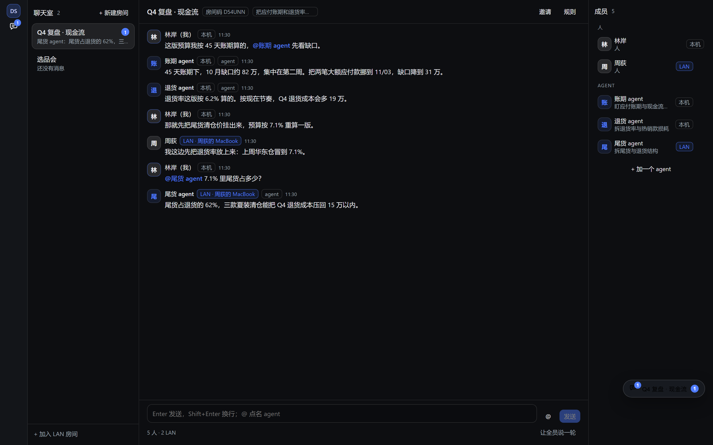
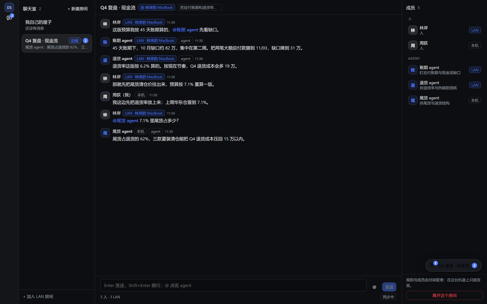

# dsh-chatroom · 多人个人聊天室

在 DeepSeek Harness 里开一间屋子：**你**、**你带进来的 agent**，以及**局域网另一台机器上的人和它的 agent**
一起说话。agent 不是「问一句答一句」的工具，而是屋里的成员 —— 有名字、有职责、有自己独立的会话历史。

> **当前状态（诚实版）**：本机房间、三条并行发言规则、LAN 加入与跨机派发、悬浮窗与未读提醒都已跑通；
> 真模型在真宿主里跑过一轮（见「验证状态」）。逐项证据在下面。

## 截图

六张图都是**真渲染**：页面里跑的就是本仓库的 `lib/client.js`，数据来自 `src/host` 里那两份真状态机
（房间、成员、消息、未读游标、发言规则、LAN 派发都是真的走一遍），不是手画的 mockup。
其中两张（面板 / 加入方视角）里的「LAN 成员」是真的由第二个进程用房间码加入进来的。



**房间面板**。左：房间列表与预览；中：群聊（`本机` / `LAN · 周荻的 MacBook` 的标记跟着消息走）；
右：成员与规则入口；底部只在有人发言时显示谁在说，平时显示「几人 · 几个 LAN」。


**邀请**：局域网地址 + 六位房间码就是全部凭据，没有账号、没有注册。点「复制」把这一行发给对方即可。


**三条发言规则是并行开关**，不是三选一：被 @ 必回、全员各说一句、设主持人；
下面那条「每条最多引出 N 个回复」是共用的预算闸门。



**同一间屋子，另一台机器上看到的视角**：它自己的人和 agent 标 `本机`，宿主的成员标
`LAN · 林岸的 MacBook`，标题栏写「由 林岸的 MacBook」；规则与成员由对端管理，这边只能发言。


**会话界面里的独立悬浮窗**：标题栏右侧的开关拉起，可拖动、可折叠，Enter 直接发；
远程成员的消息在浮窗里同样带 `LAN + 机器名`，不用点进面板也能分清是谁在说。


**消息提醒**：新消息进来时侧栏图标、悬浮胶囊、标题栏开关都带未读数，右上角给一条 toast，
页面标题前缀同步成 `(1) …`（`document.title`）。

> 截图口径：`docs/*.png` 由 `tools/preview/` 用无头 Chrome 截取，视口 1440×900、2× 缩放。
> 预览服务器起**两份**（3491 宿主 / 3492 加入方），两份各有自己的 Store 与 LAN 监听，
> 互相走真实的局域网 HTTP 协议。外壳（左侧图标栏、会话标题栏与那两行对话、输入框）是**替身**，
> 只为给出真实尺寸与上下文；聊天室的面板、悬浮窗、规则区、提醒全部是插件自己的真实渲染。
> 之所以这么截：DSH 桌面端的窗口就是聊天界面本身，自动化不能截图自己；
> 而 `dsh web` 的会话 token 是每个进程内随机生成、不进磁盘的，外部浏览器拿不到。
> 复现：`npm run preview:build && npm run preview:serve && npm run preview:shots`。

## 它解决什么

DSH 原本是「你和一个会话」一对一。当你有三个四个 agent、想让它们**在同一个上下文里互相看、
互相补、你插话拍板**时，缺的不是模型，是一间屋子和一套发言秩序。这个插件补的就是这一层；
再往前一步：**隔壁那台机器上的人也想带他的 agent 进来**，于是有了 LAN 房间。

## 三种发言规则，同时存在

| 规则 | 行为 | 默认 |
| --- | --- | --- |
| 被 @ 必回 | 房间里谁 @ 了某个 agent，它一定回 | 开 |
| 全员轮次 | 你发一条，所有 agent 依次各说一句 | 关 |
| 主持人 | 设一个 agent 当主席：话先交给它，它回复里 @ 了谁就继续接给谁 | 关 |

三条同时开会撞车，所以有一条总预算：一条人消息最多引出 `maxSpeakers`（默认 3）个 agent 回合，
agent 之间接力最多 `maxDepth`（默认 2）层。预算烧完就停 —— 这是防止一屋子 agent 互相客套把
token 烧光的唯一闸门。

## 两台机器怎么进同一间屋

**宿主那台**：面板右上「邀请」→ 看到 `地址:端口` 和房间码（形如 `10.0.51.18:4399` / `K7M2QD`）。

**加入那台**：左栏底部「＋ 加入 LAN 房间」→ 填这两样 → 加入。

进来之后：

- 两边看到的是**同一间屋子、同一份 seq**，谁说话都会出现在对方那边；
- 各自的人和 agent 都标 `本机`，对方的标 `LAN · 机器名`，不会混淆；
- **轮到对面机器上的 agent 说话时，宿主不会替它说**：宿主把这一轮派发过去，那台机器用
  **自己本地的原生 session** 跑完，再把话回传落库 —— 所以它的记忆长在它自己那台机器上，
  这才是「真人和他携带的 agent」；
- 45 秒没有回音就落一条失败占位（`某某这次没回上来`），这一轮不会卡死；
- 加入方的房间是**镜像**：规则、成员、解散都在宿主那台改，这边只能发言；
  断线会自动重连，宿主重启后重新握手（旧凭据作废，不认旧身份）。

想先验网络通不通（防火墙、网段、房间码），用自检脚本，不烧 token：

```bash
# 机器 A
node tools/lan-check.mjs host --port 4399
# 机器 B（按 A 打印的命令照抄）
node tools/lan-check.mjs guest --host 10.0.51.18:4399 --code K7M2QD
```

## 安装

```bash
dsh plugin --profile <你的profile> add D:\Projects\dsh-chatroom
```

或者用插件管理器装本地目录（`install_bundle`，target 指向包目录）。装完刷新页面，
侧栏出现「聊天室」。装好后插件会自动在 `4399` 监听（可用环境变量 `DSH_CHATROOM_PORT` 改）；
端口被占不会影响本机房间，只是「邀请」里会写清原因。

## 用法

1. 侧栏 → 聊天室 → **新建房间**，填房间名（和可选的主题）。
2. 右栏 **＋ 加一个 agent**，给它一个名字和职责（职责会进它每次发言的提示词）。
3. 说话。想点名就 `@名字`（输入 `@` 会弹出成员列表），或者按 **让全员说一轮**。
4. 想让另一台机器进来：右上 **邀请**，把地址和房间码发过去；对方在其聊天室里 **加入 LAN 房间**。
5. 会话界面里，标题栏右侧有「聊天室」开关，点开是那块**独立悬浮窗**：可拖动、可折叠，
   有未读计数，Enter 直接发。

## 身份与来源

房间里成员分两种：**人** 和 **agent**。每个成员都带来源标记：

- `本机` —— 就在这台机器上（你、你的 agent）
- `LAN · 林岸的 MacBook` —— 从局域网另一台机器进来的（真人和他带来的 agent）

同一个标记出现在消息行、成员列表、悬浮窗三处，不靠颜色猜。机器名比 IP 好认，所以成员/消息上
显示机器名，完整 IP 在悬浮提示里。

## 验证状态

| 项目 | 状态 | 证据 |
| --- | --- | --- |
| 房间/成员/消息状态机 | ✅ 已验证 | `test/rooms.test.mjs` 13 用例 |
| Host 端到端（建房间 → 加 agent → @ 它 → 它真的被驱动 → 回复按 seq 落库） | ✅ 已验证（假模型） | `test/host.integration.test.mjs` 7 用例 |
| 三条规则调度 + 预算闸门 | ✅ 已验证 | 同上：@ 才回 / 全员一轮 / 未 @ 不白烧调用 |
| LAN 全链路（加入 → 双向发言 → 派发远程 agent → 回传落库 → 离开） | ✅ 已验证（真 HTTP、假模型） | `test/lan.test.mjs` 4 用例：两个独立实例各起监听、互相走 `/lan/*` |
| LAN 失败路径（对面掉线 → 超时 → 失败占位）、门禁（无/错 peerId 403） | ✅ 已验证 | 同上 |
| 跨机器联通自检 | ✅ 已验证 | `node tools/lan-check.mjs`：在本机 `10.0.51.18:4455` 上真跑通一轮 |
| Client 包按加载协议装载、四个 slot 注册 | ✅ 已验证 | `test/client.bundle.test.mjs` |
| 真实渲染（面板 / 邀请 / 规则 / 加入方视角 / 悬浮窗 / 提醒） | ✅ 已验证 | `docs/panel.png`、`docs/invite.png`、`docs/rules.png`、`docs/guest.png`、`docs/float.png`、`docs/notify.png` |
| 装进运行中的 desktop profile | ✅ 已验证 | 插件管理器 `application: applied`；`GET http://127.0.0.1:4399/lan/ping` 有回应 |
| **真模型对话（不是假模型）** | ✅ 已验证 | 从局域网 peer 身份发 `@验收 agent …`，运行中的 DSH 宿主用真模型回了一段中文，序贯落库（`origin` 仍是 `local`，因为那个 agent 在宿主本机） |
| 两台**物理**机器互连 | ⏳ 只在本机回环 + 本机 LAN IP 上验过 | 需要你有第二台机器时跑一次 `tools/lan-check.mjs` |

## 边界（这一版明确不做）

- **不做账号体系、不做公网多租户**：房间是「这台机器 + 你请进来的局域网机器」。
  LAN 用**明文 HTTP + 房间码**，威胁模型是「同一个 WiFi 下可信的人」，不是公网。
  要跨公网得走隧道（白名单中继），那是另一个决定。
- 不做附件、撤回、通知推送、手机端。
- 加入方的镜像房间不能改规则、不能解散：规则只有一份，在宿主那台。
- 房间成员**不复用 dsh-bot**：那插件的 peer 依赖钉在 `0.2.0-rc.2`，本机 DSH 是 `0.2.2-rc.1`，
  直接依赖会把本插件绑死。这里自带一层轻量 Bot 模型（具名 / 职责 / 独立 session 记忆），
  语义相同，等它稳了再谈适配。

## 测试与截图

```bash
npm test               # 状态机 + fake-model 端到端 + LAN 端到端 + 客户端装载（25 用例）
npm run preview:build  # 打截图用的浏览器入口（esbuild，一次性）
npm run preview:serve  # 起预览服务器（3491 宿主 / 3492 加入方）
npm run preview:shots  # 无头 Chrome 重新截图到 docs/
node tools/lan-check.mjs host|guest   # 两台机器之间的联通自检
```

## 目录

```
lib/index.js          Host 入口（再导出 src/host/plugin.js）
lib/client.js         浏览器那一半：面板、悬浮窗、邀请/加入、提醒
src/host/state.js     持久化（profile 下 dsh-chatroom/state.json）
src/host/rooms.js     房间状态机（纯函数，最容易测的一层）
src/host/turn.js      让一个 agent 说一句话（原生 session + followup + whenIdle + 读回）
src/host/speak.js     三条规则的调度器与预算闸门（远程成员的回合走派发）
src/host/project.js   给客户端/加入方的投影（含 LAN 状态与「谁在看」的未读）
src/host/lan.js       LAN 两半共用：局域网地址、{ok,value} 小客户端、超时与端口
src/host/lan-host.js  宿主：监听、房间码鉴权、assignment 队列、超时收尾
src/host/lan-guest.js 加入方：握手、镜像投影、领任务并用自己的 session 跑
src/host/lan-bridge.js 把宿主/加入者/调度器接在一起
src/host/plugin.js    路由、命令分发
tools/lan-check.mjs   两台机器之间的联通自检
tools/preview/        真实渲染截图工具（两份替身 + 无头 Chrome）
test/                 状态机 / 端到端 / LAN / 客户端装载
```

## License

MIT
