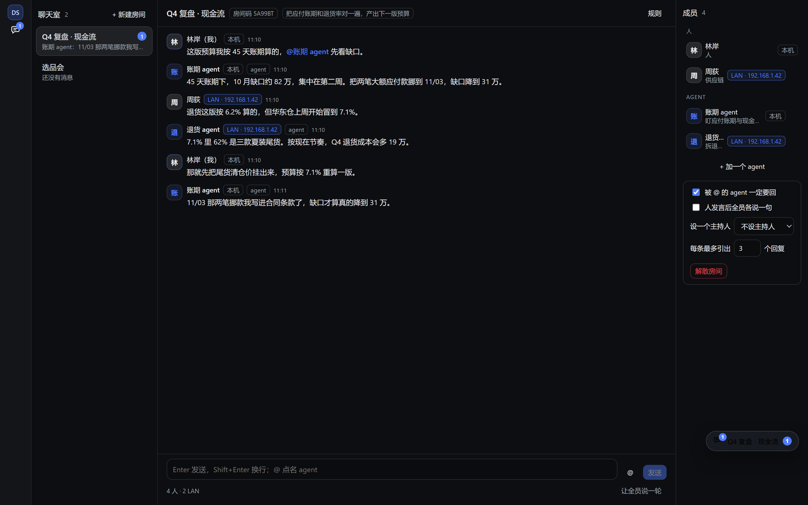
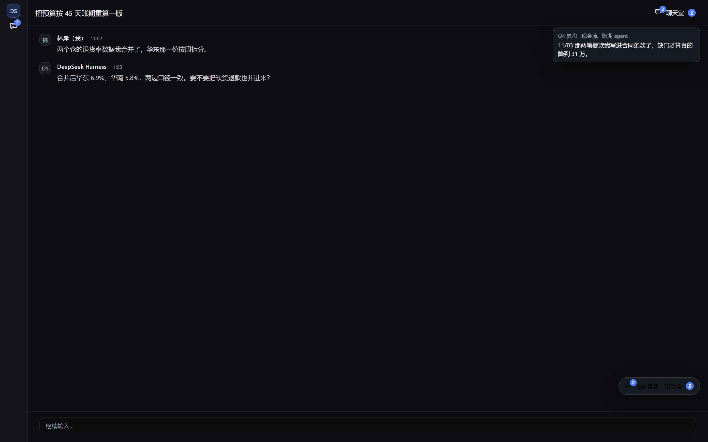

# dsh-chatroom · 多人个人聊天室

在 DeepSeek Harness 里开一间屋子：**你**和**你带进来的 agent** 一起说话。
agent 不是「问一句答一句」的工具，而是屋里的成员 —— 有名字、有职责、有自己独立的会话历史。

> **当前状态（诚实版）**：本机房间 + agent 发言已跑通并有测试，界面已出真实渲染截图；
> **LAN 加入与跨机 agent 还没做**（设计与协议已定，见 `docs/ARCHITECTURE.md`）。
> 逐项见下面「验证状态」。

## 截图

四张图都是**真渲染**：页面里跑的就是本仓库的 `lib/client.js`，数据来自 `src/host` 里那份真状态机
（房间、成员、消息、未读游标、发言规则都是真的走一遍），不是手画的 mockup。


**房间面板**。左：房间列表与预览；中：群聊（`本机` / `LAN · 192.168.x.x` 的标记跟着消息走）；
右：成员与规则入口；底部只在有人发言时显示谁在说，平时显示「几人 · 几个 LAN」。



**三条发言规则是并行开关**，不是三选一：被 @ 必回、全员各说一句、设主持人；
下面那条「每条最多引出 N 个回复」是共用的预算闸门。


**会话界面里的独立悬浮窗**：标题栏右侧的开关拉起，可拖动、可折叠，Enter 直接发；
远程成员的消息在浮窗里同样带 `LAN + IP`，不用点进面板也能分清是谁在说。



**消息提醒**：新消息进来时侧栏图标、悬浮胶囊、标题栏开关都带未读数，右上角给一条 toast，
页面标题前缀同步成 `(1) …`（`document.title`）。

> 截图口径：`docs/*.png` 由 `tools/preview/` 用无头 Chrome 截取，视口 1440×900、2× 缩放。
> 外壳（左侧图标栏、会话标题栏与那两行对话、输入框）是**替身**，只为给出真实尺寸与上下文；
> 聊天室的面板、悬浮窗、规则区、提醒全部是插件自己的真实渲染。
> 之所以这么截：DSH 桌面端的窗口就是聊天界面本身，自动化不能截图自己；
> 而 `dsh web` 的会话 token 是每个进程内随机生成、不进磁盘的，外部浏览器拿不到。
> 复现：`npm run preview:shots`（先 `npm run preview:build`）。

## 它解决什么

DSH 原本是「你和一个会话」一对一。当你有三个四个 agent、想让它们**在同一个上下文里互相看、
互相补、你插话拍板**时，缺的不是模型，是一间屋子和一套发言秩序。这个插件补的就是这一层。

## 三种发言规则，同时存在

| 规则 | 行为 | 默认 |
| --- | --- | --- |
| 被 @ 必回 | 房间里谁 @ 了某个 agent，它一定回 | 开 |
| 全员轮次 | 你发一条，所有 agent 依次各说一句 | 关 |
| 主持人 | 设一个 agent 当主席：话先交给它，它回复里 @ 了谁就继续接给谁 | 关 |

三条同时开会撞车，所以有一条总预算：一条人消息最多引出 `maxSpeakers`（默认 3）个 agent 回合，
agent 之间接力最多 `maxDepth`（默认 2）层。预算烧完就停 —— 这是防止一屋子 agent 互相客套把
token 烧光的唯一闸门。

## 安装

```bash
dsh plugin --profile <你的profile> add D:\Projects\dsh-chatroom
```

或者用插件管理器装本地目录（`install_bundle`，target 指向包目录）。装完刷新页面，
侧栏出现「聊天室」。

## 用法

1. 侧栏 → 聊天室 → **新建房间**，填房间名（和可选的主题）。
2. 右栏 **＋ 加一个 agent**，给它一个名字和职责（职责会进它每次发言的提示词）。
3. 说话。想点名就 `@名字`（输入 `@` 会弹出成员列表），或者按 **让全员说一轮**。
4. 会话界面里，标题栏右侧有「聊天室」开关，点开是那块**独立悬浮窗**：可拖动、可折叠，
   有未读计数，Enter 直接发。

## 身份与来源

房间里成员分两种：**人** 和 **agent**。每个成员都带来源标记：

- `本机` —— 就在这台机器上（你、你的 agent）
- `LAN · 192.168.1.7` —— 从局域网另一台机器进来的（真人和他带来的 agent）

同一个标记出现在消息行、成员列表、悬浮窗三处，不靠颜色猜。

## 验证状态

| 项目 | 状态 | 证据 |
| --- | --- | --- |
| 房间/成员/消息状态机 | ✅ 已验证 | `test/rooms.test.mjs` 12 用例 |
| Host 端到端（建房间 → 加 agent → @ 它 → 它真的被驱动 → 回复按 seq 落库） | ✅ 已验证（假模型） | `test/host.integration.test.mjs` 7 用例 |
| 三条规则调度 + 预算闸门 | ✅ 已验证 | 同上：@ 才回 / 全员一轮 / 未 @ 不白烧调用 |
| Client 包按加载协议装载、四个 slot 注册 | ✅ 已验证 | `test/client.bundle.test.mjs` |
| 真实渲染（面板 / 规则 / 悬浮窗 / 提醒） | ✅ 已验证 | `docs/panel.png`、`docs/rules.png`、`docs/float.png`、`docs/notify.png` |
| 装进 profile | ✅ 已验证 | 插件管理器返回 `application: applied` |
| **真模型对话（不是假模型）** | ⏳ 未验证 | 截图用假模型；真模型要在真宿主里点一次 |
| **LAN 加入 / 跨机 agent** | ⏳ 未实现 | 设计与协议见 `docs/ARCHITECTURE.md` |

## 边界（这一版明确不做）

- 不做账号体系、不做公网多租户：房间是「这台机器 + 你请进来的局域网机器」。
- 不做附件、撤回、通知推送、手机端。
- 房间成员**不复用 dsh-bot**：那插件的 peer 依赖钉在 `0.2.0-rc.2`，本机 DSH 是 `0.2.2-rc.1`，
  直接依赖会把本插件绑死。这里自带一层轻量 Bot 模型（具名 / 职责 / 独立 session 记忆），
  语义相同，等它稳了再谈适配。

## 测试与截图

```bash
npm test               # 状态机 + fake-model 端到端 + 客户端装载
npm run preview:build  # 打截图用的浏览器入口（esbuild，一次性）
npm run preview:serve  # 起预览服务器（默认 3491）
npm run preview:shots  # 无头 Chrome 重新截图到 docs/
```

## 目录

```
lib/index.js          Host 入口（再导出 src/host/plugin.js）
lib/client.js         浏览器那一半：面板、悬浮窗、提醒
src/host/state.js     持久化（profile 下 dsh-chatroom/state.json）
src/host/rooms.js     房间状态机（纯函数，最容易测的一层）
src/host/turn.js      让一个 agent 说一句话（原生 session + followup + whenIdle + 读回）
src/host/speak.js     三条规则的调度器与预算闸门
src/host/plugin.js    路由、命令分发、投影
tools/preview/        真实渲染截图工具（假模型替身 + 无头 Chrome）
test/                 状态机 / 端到端 / 客户端装载
```

## License

MIT
